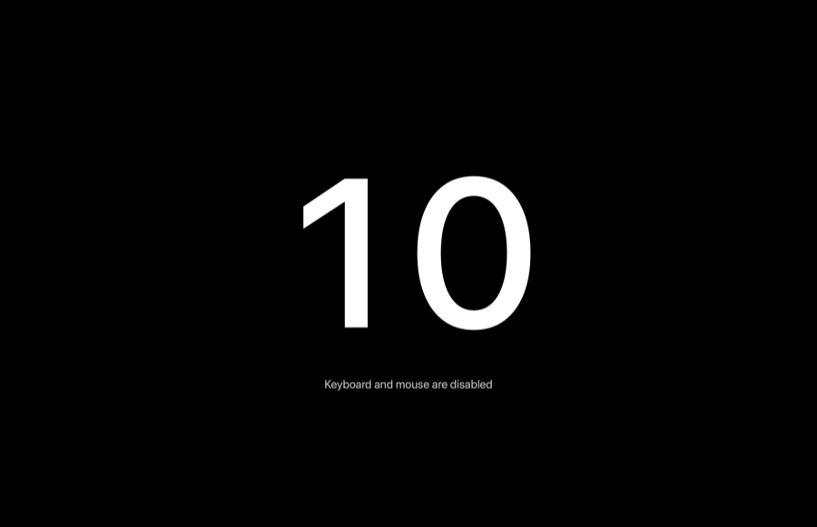

# WipeLock

A tiny macOS menu bar app that locks your keyboard, mouse and trackpad for a few seconds so you can wipe them down without clicking or typing anything by accident.

Click the menu bar icon and every screen goes black with a white countdown. Input comes back by itself when the countdown ends.



## Features

- One click in the menu bar starts the lock (10 seconds by default)
- Blocks keys, clicks, scrolling, trackpad gestures and media keys
- Freezes and hides the cursor, and turns off app switching and Force Quit while locked
- Black full-screen countdown on every connected display
- Right-click (or Option-click) the icon to pick a duration from 5 to 120 seconds, or to quit
- No network access, no data collection, no dependencies

## Requirements

- macOS 13 Ventura or later
- Xcode or the Xcode Command Line Tools (for `swiftc`)

## Build and install

```bash
git clone https://github.com/TheMosh/wipelock.git
cd wipelock
./build.sh
cp -R build/WipeLock.app /Applications/
open /Applications/WipeLock.app
```

## Permission

WipeLock needs **Accessibility** access to block input. On first launch macOS asks for it; you can also turn it on in **System Settings → Privacy & Security → Accessibility**.

The app is signed ad hoc, so each rebuild looks like a new app to macOS. After rebuilding, remove WipeLock from the Accessibility list with the − button and add it again.

## Things to know

- **The power / Touch ID key can't be blocked** by any app. A short press locks or sleeps the Mac, and holding it shuts the Mac down, so wipe it gently.
- If WipeLock crashes or is quit, macOS removes its event tap and input comes back straight away, so you can't get stuck.
- The Caps Lock light may still toggle, but nothing gets typed.

## How it works

WipeLock installs a HID-level `CGEventTap` that swallows every input event for the length of the countdown, and shows a borderless black window at shielding level on each screen. The code is four small Swift files in [`Sources/`](Sources):

| File | What it does |
| --- | --- |
| `AppDelegate.swift` | Menu bar icon, menu, countdown timer |
| `InputBlocker.swift` | The event tap that blocks input |
| `OverlayWindow.swift` | The black countdown screen |
| `main.swift` | App entry point |

## License

MIT. See [LICENSE](LICENSE).
